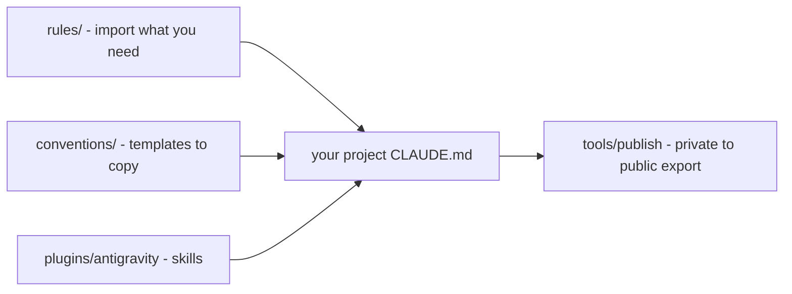

# devkit


Shared agent rules, conventions, and Claude Code skills for multi-project workflows
(queue discipline, plan hubs, publish/export, intake).

This public tree is the portable subset. Clone it next to your projects, or `@`-import
individual files from `rules/`.

## Who is this for

You run several repositories with coding agents (Claude Code) and want the same working rules
in all of them: how a session starts, how plans and tasks are kept, how long jobs are queued,
how a private repo is exported to a public mirror. devkit is a set of small Markdown rules you
import, templates you copy, and one plugin; it is not a framework and has no runtime.

## How the pieces fit



## What ships here

| Path | Contents |
|------|----------|
| `rules/` | Portable rules (`queue`, `plan-structure`, `house-standard`, `publish`, …) |
| `conventions/` | Templates for `plan/NOW`, `tasks`, STATUS, archive, publish manifests |
| `plugins/antigravity/` | Claude Code plugin: `/optimize`, `/queue-task`, `/publish`, `/handoff`, `/new-problem`, `/benchmark`, … |
| `tools/publish/` | Allowlist export → public GitHub mirrors (scan / verify / gated push) |

Companion OSS product: [taskqueue](https://github.com/wwylon/taskqueue) (daemon, `tq` CLI, web UI, MCP).

## Quick start (worked example)

Starting a new project `my-project` next to a checkout of devkit:

```text
projects/
  devkit/            <- this repository, pinned (see below)
  my-project/
    CLAUDE.md
    plan/NOW.md
```

`my-project/CLAUDE.md`:

```markdown
@../devkit/rules/agent-context.md
@../devkit/rules/plan-structure.md
@../devkit/rules/queue.md

# CLAUDE.md — my-project
Read plan/NOW.md first. One task per session.
```

Copy the `conventions/` templates to create `plan/NOW.md` and `plan/tasks.md`. Start a Claude Code
session in `my-project/`: the imported rules load, and the agent follows the plan and queue discipline.

## Pin a version

Consumers should pin a release rather than track `master`:

```text
git clone https://github.com/wwylon/devkit.git
git -C devkit checkout v0.1.1
```

Versions follow [Semantic Versioning](https://semver.org/); changes are listed in
[CHANGELOG.md](CHANGELOG.md).

## Plugin install

Point a local Claude Code marketplace at this checkout:

```json
// ~/.claude/plugins/known_marketplaces.json
"antigravity-devkit": {
  "source": { "source": "local", "path": "/path/to/devkit" },
  "installLocation": "/path/to/devkit"
}
```

Each project's `.claude/settings.local.json`:

```json
"enabledPlugins": { "antigravity@antigravity-devkit": true }
```

## Using the rules

Import the rules you need from `rules/` (e.g. `@devkit/rules/queue.md`). Typical set for a
queued research project: `queue`, `plan-structure`, `documentation-standards`, `agent-context`.

`bug-patterns.md` is for fixes, not every session. `publish.md` only when shipping a public mirror.

## Plan hub (in *your* projects)

devkit itself has no `plan/` directory. Consumer projects keep session priority in their own
`plan/NOW.md` (see [`rules/plan-structure.md`](rules/plan-structure.md)). Recommended layout:

- `plan/README.md` — dashboard
- `plan/NOW.md` — doing / next / waiting
- `plan/tasks.md` — active tasks only
- `plan/STATUS.md` — idea decisions (research portfolios)
- `plan/archive/` — completed acceptance prose

Templates live under [`conventions/`](conventions/).

## Publish tooling

```text
python tools/publish/cli.py --project-root /path/to/your-project doctor
python tools/publish/cli.py --project-root /path/to/your-project release --dry-run
python tools/publish/cli.py --project-root /path/to/your-project release --i-mean-it
```

See [`rules/publish.md`](rules/publish.md) and [`tools/publish/README.md`](tools/publish/README.md).

## Contributing and security

See [CONTRIBUTING.md](CONTRIBUTING.md), [CODE_OF_CONDUCT.md](CODE_OF_CONDUCT.md) and [SECURITY.md](SECURITY.md).

## License

MIT — see [LICENSE](LICENSE).
