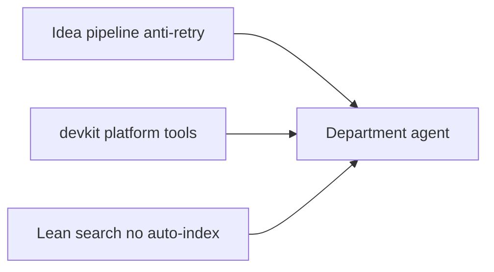

# Antigravity House Standard (final)

## Locked decisions

| Topic | Choice |
|-------|--------|
| Role | You orchestrate; agents code in one directory each |
| Machine | No watchers; no post-edit DB/pack updates; Grep beats stale indexes |
| Heavy index | GrepAI/Repowise cold + `stop-all` only when idle; Arbor **off** (`daily.arbor: []`); SCIP **out** |
| Docs | Extend existing `devkit/rules/*`; create `resource-policy.md` + thin `house-standard.md` only |
| MCP profile data | Keep reading [`bridge2/config/mcp_servers.json`](d:/antigravity/bridge2/config/mcp_servers.json) from moved `devkit/tools/generate_mcp_config.py` (no second profiles file) |
| mcp-indexers.mdc | Thin **appendix** (bridge2 paths only); body SSOT = `devkit/rules/mcp-indexers.md` |
| Wave2 bridge2 scripts | Thin wrappers 1 release, then skills/docs call `devkit/tools/` directly |
| Packers | Repomix `--compress` = skeleton; one `devkit` pack_code + manifests = full parts |
| Ideas | One pipeline in `external-intake.md`; adapters only for ledger paths; anti-retry mandatory |
| Plan layouts | Slim default; Bridge2 rich + Face INDEX stay forked |
| Delivery | **MVP → pause → Wave2 → pause → Wave3** |
| Install | Prefer global `ast-grep-mcp-server`, `ctags`, `repomix` on PATH; npx fallback OK |

---

## Purpose and non-goals

**Purpose:** Same idea→ticket→close process and same search/token rules across active products; platform code in `devkit`; product trees stay domain-specific.

**Non-goals:** Always-fresh indexes · SCIP · unifying Bridge2/Face plans · CPE outside bridge2-family · indexing scratch/oracle dirs · boiling ocean before MVP ships.

**MVP product scope (must touch):** `devkit`, root `CLAUDE.md`, `bridge2` (+ note for clones via later distribute), `dds_alpha`, `pimc`, `pokerbot`, `omnicard3`, `taskqueue` (templates/ignores/imports as applicable).

**Defer activate:** `omnisite`, `codeflow`, empty trees — scaffold when first real work starts.

---

## Architecture (three pillars)



1. **Ideas** — drop → ingest → dedupe → verify → promote → work → close  
2. **Platform** — shared scripts/ignores/MCP generator in `devkit`  
3. **Search** — L0→L1→L2; idle-cheap MCP; operator cold only  

---

## Pillar A — Shared idea pipeline

Extend [`devkit/rules/external-intake.md`](d:/antigravity/devkit/rules/external-intake.md) (Bridge2 local rule keeps domain routing only).

| Stage | Do | Record |
|-------|-----|--------|
| 0 Drop | `plan/external/<N>/` | path, date, source |
| 1 Ingest | One theme row (not one per file) | `intake_progress.md` |
| 1b Dedupe | Search closed ledgers **before** new id | link prior id or continue |
| 2 Verify | Grep/code; never promote on LLM claim alone | ⏳→🔍→✅/❌ |
| 3 Promote | Adapter maps to F / IDEA / T / STATUS | id on intake row |
| 4 Work | One ticket / session | NOW or queue |
| 5 Close | **Required** disposition | reason + evidence |

### Dispositions (do not retry without new evidence)

| Closed | Retry? |
|--------|--------|
| `shipped` / `adopt` / `opt-in` | No (unless regression) |
| `park` | Only if unlock criteria written |
| `reject` | No |
| `trial-reverted` | No (+ note/ADR) |
| `obsolete` / `dup` | No (cite survivor) |
| `already_landed` | No |

**Task** verbs (`doing`/`todo`/`done`) stay in `tasks.md` / queues. **Idea** dispositions stay in STATUS / idea registers / `ideas_closed.md`. Do not mix columns.

### Adapters (ledger location only)

| Family | Open | Closed | Intake |
|--------|------|--------|--------|
| Bridge2 | `registers/ideas/<domain>.md` | Archive section + ADRs | `external/N/intake_progress.md` |
| Slim | `STATUS.md` / `tasks.md` | never delete reject rows; prefer `plan/ideas_closed.md` | same `intake_progress` shape |
| Face | Face plans | decisions/STATUS | external when used |

Templates: `devkit/conventions/intake_progress.md`, `ideas_closed.md`.

### Cross-product

`products: [...]` + [`product_chains.yaml`](d:/antigravity/devkit/tools/product_chains.yaml) (Wave2). Upstream `reject` → downstream note `dup`/`obsolete` (manual MVP; `idea_dedupe.py` Wave3).

---

## Pillar B — Share via devkit (fix inverted SSOT)

| Move / create | From → To |
|---------------|-----------|
| Indexer impl | `bridge2/scripts/dev_index_*.py` → `devkit/tools/indexers/` |
| MCP generate + preflight | `bridge2/scripts/` → `devkit/tools/` (still reads bridge2 `mcp_servers.json`) |
| pack_code core | 9 forks → `devkit/tools/pack_code/` + per-repo `pack_manifest.yaml` |
| Ignore bases | copy-paste → `devkit/conventions/*ignore*.base` |
| Strip `@*` | bridge, bridge2, pimc CLAUDE (parent already loads those rules) |

**Keep local:** Bridge2 queues/ops/handoff_brief, Face INDEX, domain invariants, CPE/multi-clone.

---

## Pillar C — Single-PC search and tokens

### Rules R1–R7

No auto-index after edit · MCP idle≈free · heavy = operator only · Grep > stale DB · scoped packs only · no GPU/search background burn · prefer one heavy workspace when tight.

### L0→L1→L2

| Level | Tools | ~tokens |
|-------|-------|---------|
| L0 | NOW, short ARCH, wiki query, scoped compress | 0.5–2k |
| L1 | Grep/`rg` -C 2..5, ast-grep-mcp, ctags find | 0.1–0.5k |
| L2 | One function/class window | 0.3–1k |

### Daily MCP target

- On: grepai (query), repowise (limited list), **ast-grep**, **mcp-ctags**  
- Off: Arbor  
- Wave2: optional **repomix** MCP (scoped compress only)  
- Agents forbid: watch, `repowise update`, `refresh_tags` habit, unscoped pack, `scip-clang`

### Packers

| Mode | Tool | When |
|------|------|------|
| Skeleton | Repomix `--compress` | External LLM / architecture |
| Full parts | pack_code + manifest | Need real bodies |
| Never | Both full dumps for one ask | — |

---

## Session (all departments)

1. Intake first if user dropped external ideas  
2. Read NOW → **one** ticket  
3. L0→L1→L2 (no whole-repo dump)  
4. Close ticket + idea disposition if applicable  
5. Cross-repo → follow product_chains  

Slim: `plan/NOW.md` + `tasks.md`. Rich: Bridge2 `NOW-*` / queues. Face: INDEX.

---

## Waves

### MVP (execute first)

1. `resource-policy.md`, `house-standard.md`; extend mcp-indexers, agent-tool-surface, external-intake, plan-structure note; root CLAUDE; README consumer table; strip `@*`.  
2. Intake/closed templates; scaffold slim gaps; `dds_alpha/plan/NOW.md`; Bridge2 mapping note (Archive ≡ closed).  
3. `daily.arbor: []`; ast-grep-mcp + mcp-ctags in generator; `check_path.py`; Bridge2 `AGENT_TOOL_SURFACE` L0 recipes; thin mdc appendix.  
4. Ignore bases + apply; `house_compliance.py` / `scaffold_house_project.py`.

**MVP smoke**

- [ ] Generated daily MCP has no Arbor  
- [ ] `check_path.py` reports rg/fd/ast-grep-mcp/ctags (or documents missing)  
- [ ] Root session loads resource-policy + extended intake  
- [ ] Grep of bridge/bridge2/pimc CLAUDE shows no parent-duplicate `@*`  
- [ ] `dds_alpha` has NOW.md  
- [ ] ≥3 unique actives have closed-idea surface or STATUS reject retention  
- [ ] No new watcher started by house docs/scripts  

**Stop and wait for OK before Wave 2.**

### Wave 2

Move MCP/indexer impl to `devkit`; thin wrappers; `product_chains.yaml` + registry cleanup; tags regen; Repomix base + `skeleton_pack`; optional Repomix MCP; Bridge2 overlay.

**Smoke**

- [x] `devkit/tools/dev_index.py` / control oneshot call `tools/indexers/` (not bridge2 bodies)
- [x] Bridge2 `scripts/{generate_mcp_config,mcp_preflight,dev_index_*}.py` are thin wrappers
- [x] `python devkit/tools/generate_mcp_config.py --profile daily` (no Arbor)
- [x] `regen_tags.py --project bridge2` → `.tags` contains a known symbol
- [x] `skeleton_pack.py --project bridge2 --include …` → `packed/bridge2-skeleton/`
- [x] Repomix MCP deferred (CLI `skeleton_pack` only; unscoped pack still banned)

**Stop and wait for OK before Wave 3.**

### Wave 3

pack_code core + migrate forks (bridge2 → bridge/omnicard3/llm_localize → rest); `intake_cli` + `idea_dedupe`; chain reject notes; remaining CLAUDE/plugin; runbook; compliance GREEN.

**Smoke**

- [x] `idea_dedupe` hits known Bridge2 reject (IDEA-HTN-151)
- [x] `intake_cli drop` / `chain-note` available
- [x] `pack_code --parts htn` list matches `golden_htn_files.txt`
- [x] bridge2 `scripts/pack_code.py` thin wrapper → portable CLI for `--parts`
- [x] Other unique forks migrated: bodies in `projects/*_legacy.py`, thin wrappers + directory manifests (taskqueue legacy_only)
- [x] `HOUSE_RUNBOOK.md` + external-intake chain commands
- [x] `house_compliance.py` GREEN

**Wave 3 complete.**

---

## Target tree (devkit)

```text
devkit/
  rules/     # extend + resource-policy.md + house-standard.md
  conventions/  # + ignore bases, intake_progress, ideas_closed
  tools/
    indexers/   # from bridge2
    generate_mcp_config.py, mcp_preflight.py
    agent_search/  # check_path, regen_tags, excludes, ast-grep, skeleton_pack
    pack_code/
    intake/     # Wave3
    product_chains.yaml
    house_compliance.py, scaffold_house_project.py
  plugins/antigravity/
```

**Durable copy of this plan when executing:** `devkit/docs/HOUSE_STANDARD_PLAN.md` (or `devkit/plan/`) so it is not only in Cursor plan UI.

---

## Operator cheat sheet (post–Wave 3)

See [HOUSE_RUNBOOK.md](HOUSE_RUNBOOK.md). Quick:

```powershell
python <portfolio-root>\devkit\tools\agent_search\check_path.py
python <portfolio-root>\devkit\tools\generate_mcp_config.py --profile daily
python <portfolio-root>\devkit\tools\house_compliance.py --root <portfolio-root>
python <portfolio-root>\devkit\tools\pack_code\cli.py --project bridge2 --parts htn --list-only
python <portfolio-root>\devkit\tools\intake\idea_dedupe.py --project bridge2 --theme "IDEA-HTN-151"
```

Canonical: `devkit/tools/generate_mcp_config.py` (bridge2 `scripts/` = thin wrapper).

---

## Risks and rollback

| Risk | Mitigation |
|------|------------|
| Indexer move breaks cold index | Wrappers + smoke before delete |
| Distribute resets CLAUDE | Fix hub first; verify one clone |
| pack_code drift | Golden `--parts htn` compare |
| IDE MCP sprawl | arbor []; limited repowise; grepai-only profile |
| Idea disposition vs task status confusion | Document column separation in plan-structure |

Rollback: restore `mcp_servers.json` / bridge2 scripts / CLAUDE imports; ignore-base reverts; new devkit tools are delete-safe (no engine runtime dep).

---

## Done when

1. MVP smoke checklist green.  
2. Wave2: portfolio cold index/MCP generate hosted in `devkit`.  
3. Wave3: one pack_code core; idea dedupe works; compliance GREEN.  
4. Agents follow anti-retry + L0→L1→L2; no auto-index.  
5. Consumer table matches CLAUDE imports.

---

## Start

**Execute MVP only.** After MVP smoke, stop for confirmation before Wave 2 (script moves) and Wave 3 (pack/intake automation).
